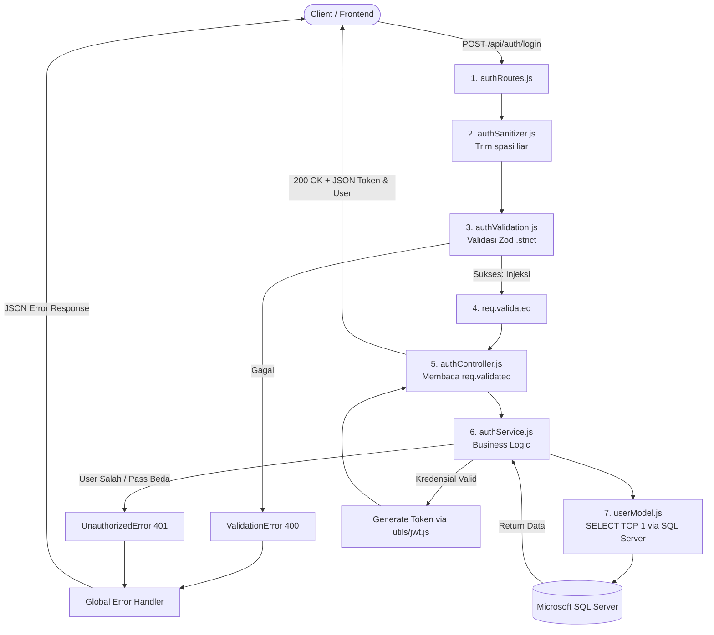

# 📘 Panduan & Penjelasan Arsitektur Backend (SoC & Clean Architecture)

Dokumen ini disusun sebagai panduan referensi lengkap untuk memahami, menjelaskan, dan mempresentasikan arsitektur backend yang telah dibangun kepada interviewer, lead engineer, atau tim penguji.

---

## 📑 Daftar Isi
1. [Elevator Pitch (30 Detik)](#1-elevator-pitch-30-detik)
2. [Nama Style & Prinsip Arsitektur](#2-nama-style--prinsip-arsitektur)
3. [Alur Request (Request Lifecycle)](#3-alur-request-request-lifecycle)
4. [Peran Masing-Masing Folder & File](#4-peran-masing-masing-folder--file)
5. [Tanya-Jawab Teknis: "Kenapa Bikin Gini?"](#5-tanya-jawab-teknis-kenapa-bikin-gini)
6. [Skrip Presentasi Langsung (Contekkan Bicara)](#6-skrip-presentasi-langsung-contekkan-bicara)

---

## 1. Elevator Pitch (30 Detik)

> *"Backend ini dibangun menggunakan **Node.js, Express, dan Microsoft SQL Server** dengan menerapkan pola **Clean Layered Architecture** dan prinsip **Separation of Concerns (SoC)**.*
>
> *Alur datanya mengadopsi konsep gatekeeping yang ketat: setiap request yang masuk harus melalui tahap **sanitasi** dan **validasi skema Zod** terlebih dahulu sebelum menyentuh **Controller**. Controller hanya bertugas menerjemahkan HTTP, sedangkan seluruh logika bisnis berada di **Service**, dan interaksi database diisolasi di dalam **Model** menggunakan query yang aman dan terindeks."*

---

## 2. Nama Style & Prinsip Arsitektur

Jika ditanya apa arsitektur atau pola desain yang digunakan, gunakan terminologi standar industri berikut:

* **Separation of Concerns (SoC)**: Memisahkan kode berdasarkan tanggung jawab fungsionalnya (HTTP $\neq$ Bisnis $\neq$ Database).
* **Single Responsibility Principle (SRP)**: Satu file/modul hanya memiliki satu alasan untuk berubah.
* **Clean Layered MVC**: Lapisan berlapis yang terisolasi (*Route $\rightarrow$ Validation $\rightarrow$ Controller $\rightarrow$ Service $\rightarrow$ Model*).
* **Fail-Fast & Strict Input Gatekeeping**: Memvalidasi data di pintu gerbang (*middleware*) dan langsung menolak request cacat dengan `400 Bad Request` sebelum membebani server atau database.
* **Decoupled Application & Server Lifecycle**: Memisahkan inisialisasi Express (`app.js`) dari listener port dan koneksi jaringan (`server.js`).

---

## 3. Alur Request (Request Lifecycle)

### Penjelasan Tahapan:
1. **Client Request**: Mengirim data `{ "username": "user123", "password": "password123" }`.
2. **Route (`authRoutes.js`)**: Menentukan endpoint URL dan method HTTP.
3. **Sanitizer (`authSanitizer.js`)**: Membersihkan input mentah (misal: `.trim()` spasi berlebih pada username).
4. **Validator (`authValidation.js`)**: Memvalidasi tipe dan batasan karakter menggunakan skema ketat Zod (`.strict()`). Jika payload tidak sesuai, dilempar `ValidationError` (HTTP 400).
5. **Injeksi `req.validated`**: Data bersih diteruskan secara aman ke controller via properti `req.validated`.
6. **Controller (`authController.js`)**: Menerima `req.validated`, memanggil `loginService`, dan mengembalikan response JSON `200 OK`.
7. **Service (`authService.js`)**: Menjalankan logika bisnis: memanggil model user, membandingkan hash password dengan `bcrypt.compare()`, dan men-generate JWT token.
8. **Model (`userModel.js`)**: Menjalankan query SQL Server teroptimasi (`SELECT TOP 1`) dengan parameterized query `@username`.

---

## 4. Peran Masing-Masing Folder & File

| File / Direktori | Tanggung Jawab Utama |
| :--- | :--- |
| **`src/server.js`** | **Entrypoint runtime**. Memastikan koneksi database SQL Server sukses sebelum memanggil `app.listen()`, serta menangani *graceful shutdown* (`SIGINT`/`SIGTERM`). |
| **`src/app.js`** | **Setup Express**. Mendaftarkan middleware global (`cors`, `express.json` limit 10kb), routing `/api/auth`, health check (`/health`), 404 handler, dan centralized error handler. |
| **`src/validations/`** | Berisi kontrak skema validasi menggunakan **Zod** dengan opsi `.strict()` untuk menolak properti ilegal. |
| **`src/sanitizers/`** | Fungsi pembersih field input sebelum divalidasi oleh skema Zod. |
| **`src/middleware/`** | `validate.js` untuk eksekusi validator & pengisian `req.validated`. `errorHandler.js` untuk menangkap semua error secara terpusat. |
| **`src/controllers/`** | **HTTP Translator**. Menerjemahkan request HTTP menjadi pemanggilan service, lalu mengirim kembali status code dan JSON. Dilarang mengakses Model langsung. |
| **`src/services/`** | **Business Logic Core**. Menampung semua aturan bisnis, verifikasi hash bcrypt, orkestrasi model, dan pembuatan JWT. |
| **`src/models/`** | **Data Access Layer**. Khusus mengeksekusi query ke SQL Server menggunakan parameterized input. |
| **`src/constants/`** | Nilai konstan domain (`httpStatusCodes.js`, `authConstants.js`) yang dibekukan menggunakan `Object.freeze()` agar tidak dapat dimutasi saat runtime. |
| **`src/errors/`** | Kelas custom error (`AppError`, `ValidationError`, `UnauthorizedError`, `NotFoundError`) untuk standarisasi status code. |
| **`src/utils/`** | Helper modular independen seperti pembuatan dan verifikasi JWT (`jwt.js`). |

---

## 5. Tanya-Jawab Teknis: "Kenapa Bikin Gini?"

Berikut adalah pertanyaan yang paling sering diajukan oleh tech lead atau interviewer, beserta jawaban berbobot yang bisa Anda sampaikan:

### Q1: Kenapa memisahkan `app.js` dan `server.js`?
> **Jawaban**:
> *"Untuk memisahkan konfigurasi aplikasi web dari network listener. File `app.js` bisa di-import langsung oleh automated integration test (misal menggunakan Supertest) tanpa harus membuka port fisik yang bisa memicu bentrok port (EADDRINUSE). Sementara `server.js` khusus bertanggung jawab atas lifecycle server: handshake database, port listening, dan graceful shutdown saat menerima sinyal OS."*

---

### Q2: Kenapa di Model tidak melakukan `SELECT *` lalu dicari pakai `Array.find()` di Node.js?
> **Jawaban**:
> *"Itu in-memory filtering yang merupakan anti-pattern fatal. Menarik semua baris data ke Node.js akan memboroskan bandwidth jaringan dan dapat membuat RAM server habis (Out of Memory) jika tabel membesar.*
> 
> *Di model ini, saya menggunakan `SELECT TOP 1 ... WHERE username = @username`. Karena kolom `username` diberi constraint `UNIQUE`, SQL Server otomatis memanfaatkan **Unique B-Tree Index** untuk melakukan **Index Seek** ($O(\log N)$) langsung ke baris target tanpa melakukan Table Scan."*

---

### Q3: Kenapa Controller dilarang memanggil Model secara langsung?
> **Jawaban**:
> *"Agar controller tetap berfokus pada urusan HTTP (parsing status code, header, response format). Jika Controller langsung query ke Model, logika bisnis akan tersebar acak di controller. Akibatnya, logika tersebut sulit diuji secara unit test (harus mock HTTP req/res) dan tidak bisa dipakai ulang jika suatu saat fitur login ingin dipanggil dari background job, CLI script, atau message broker."*

---

### Q4: Kenapa memakai Zod dan properti `req.validated`?
> **Jawaban**:
> *"Untuk menerapkan konsep **Fail-Fast Gatekeeping** dan mencegah celah keamanan **Mass Assignment Vulnerability**. Dengan Zod `.strict()`, jika klien mengirim properti asing yang tidak dikenal, request langsung ditolak.*
> 
> *Data yang lolos disimpan di `req.validated` sehingga controller dan service terjamin 100% hanya mengolah data yang sudah bersih dan bertipe benar."*

---

### Q5: Kenapa error handling tidak memakai blok `try-catch` manual di setiap controller?
> **Jawaban**:
> *"Kami menerapkan **Centralized Error Handling**. Controller cukup menangkap error lalu mengoperkannya ke `next(error)`. Di middleware akhir, error diidentifikasi berdasarkan tipenya (`ValidationError`, `UnauthorizedError`, atau server failure) untuk menghasilkan respon JSON yang seragam bagi frontend/klien."*

---

## 6. Skrip Presentasi Langsung (Contekkan Bicara)

Gunakan naskah ini jika Anda diminta menjelaskan langsung secara lisan:

> *"Halo, izinkan saya menjelaskan arsitektur backend fitur autentikasi ini.*
>
> *Backend ini dirancang dengan prinsip **Separation of Concerns** dan **Layered Architecture** untuk menjamin skalabilitas, keamanan, dan kemudahan pengujian.*
>
> *Saat request login masuk, alurnya dimulai dari rute yang pertama kali mengarahkan request ke middleware sanitasi dan validasi menggunakan **Zod**. Di tahap ini, input dibersihkan dan dicek secara ketat. Jika username atau password kosong, request langsung di-cut off di pintu gerbang dengan status 400 Bad Request.*
>
> *Data yang valid disimpan di `req.validated` dan diteruskan ke `authController`. Controller di sini sengaja dibuat tipis (lean), hanya bertugas membaca data dan memanggil `authService`.*
>
> *Di dalam Service, logika bisnis berjalan: kita memanggil `userModel` untuk memeriksa user di SQL Server, lalu membandingkan password dengan hash `bcrypt`. Jika cocok, service membuat JWT token dan mengembalikannya ke controller.*
>
> *Di sisi database, pencarian user dioptimalkan dengan query parameterized `SELECT TOP 1` pada kolom `username` yang sudah memiliki Unique Index, sehingga query berjalan instan (Index Seek) dan kebal terhadap SQL Injection.*
>
> *Terakhir, semua error diatur secara terpusat oleh Centralized Error Handler sehingga klien selalu mendapatkan response error dengan format JSON yang rapi dan konsisten.*
>
> *Demikian garis besar arsitekturnya, silakan jika ada bagian yang ingin ditanyakan lebih lanjut."*
